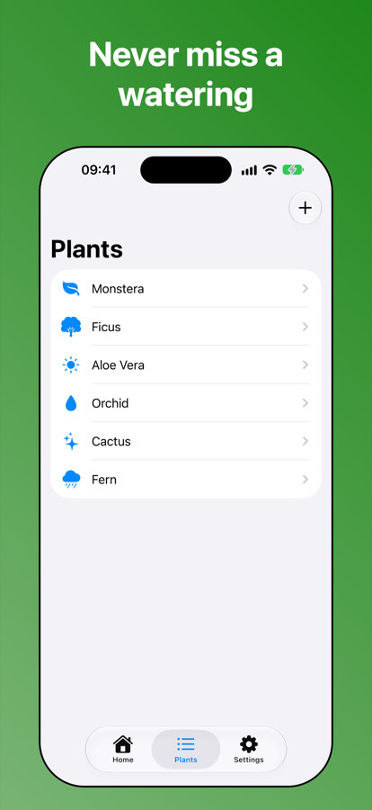

# ios-screenshot-automator

App Store screenshots from **one config file and one command**. Your UI tests only navigate and call `shot("Name")`; the `screenshots` tool picks simulators, captures every language, adds background, device outline and headline, and checks the result against Apple's rules.

<p align="center">
  
</p>

## What you get

- iPhone, iPad, iPhone Duo (outer and inner display) and Apple TV, in every language, light and dark (dark is not available on Apple TV).
- Exact App Store pixel sizes, no alpha channel, at most 10 images per size, same shots in all languages (the tool checks and fails otherwise).
- Status bar 9:41 with full battery and signal, deterministic launches, no screenshot scripts to copy into your apps.
- Frames drawn from the simulator's own device data (stylized outline or bezel) or your own frame PNG. No Apple artwork is shipped.

Mac and Apple Watch are **not verified yet**, see [issue #6](https://github.com/matthias-karl/ios-screenshot-automator/issues/6).

## Requirements

macOS with Xcode 27 (the tool reads the simulators' device profiles). Simulators for the sizes you want must be installed. A missing simulator is an error; the tool never falls back to another size.

## Install

```bash
git clone https://github.com/matthias-karl/ios-screenshot-automator.git
ios-screenshot-automator/Scripts/install.sh      # builds and links ~/.local/bin/screenshots
```

Add the Swift package to your **UI-test target** in Xcode (File ▸ Add Package Dependencies, product `ScreenshotAutomator`).

## Quick start

1. In your app folder: `screenshots init`. It finds the project, asks a few questions and writes `screenshots.json` and a UI-test scaffold. Add the new test file to your UI-test target.
2. Write the test. Navigation only, no setup code, no device names:

   ```swift
   import XCTest
   import ScreenshotAutomator

   final class Screenshots: ScreenshotTestCase {
       func testHome() {
           launch()
           shot("01_Home")
           tap(id: "button.add")          // any accessibilityIdentifier
           shot("02_Plants")
       }
       func testDetail() {
           launch(extraArguments: ["-SCREEN", "plantDetail"])   // start directly in a state
           shot("03_Detail")
       }
   }
   ```

3. Make your app react to the launch arguments `ScreenshotTestCase` sets: `-UITEST`, `-LOAD_MOCK_DATA`, `-DISABLE_ANIMATIONS`, `-SKIP_ONBOARDING`.
4. Add headlines per shot and language to `screenshots.json`, then run:

   ```bash
   screenshots run
   ```

Results land in `screenshots/final/<language>/<size>_<shot>.png` (ready for `fastlane deliver`), an overview in `screenshots/index.html`.

A minimal `screenshots.json`:

```json
{
  "version": 2,
  "project": "MyApp.xcodeproj",
  "targets": [
    { "platform": "iOS", "scheme": "MyApp", "tests": "MyAppUITests/Screenshots",
      "sizes": ["iphone-6.3", "iphone-6.9", "ipad-13"] }
  ],
  "languages": ["en-US", "de-DE"],
  "style": {
    "background": { "gradient": ["#1f881b", "#79b474"], "angle": 135 },
    "frame": "outline"
  },
  "shots": {
    "01_Home": { "title": { "en-US": "All your plants at a glance", "de-DE": "Alle Pflanzen im Blick" } }
  }
}
```

## Commands

| Command | Purpose |
|---|---|
| `screenshots init` | Wizard: project, scheme, sizes, languages, style; writes config and test scaffold. |
| `screenshots run` | Capture, compose, validate. Filters: `--size`, `--language`, `--scheme`. |
| `screenshots compose` | Rebuild final images from existing raw images, no simulator. |
| `screenshots check` | Check config, installed simulators and required sizes. Changes nothing. |
| `screenshots sizes` | List all known sizes and the simulator chosen for each. |

Exit code 0 means success, 1 a missing image or failed check, 2 an invalid configuration.

## Coding agents

The skill [`skills/ios-screenshots`](skills/ios-screenshots/SKILL.md) teaches Claude Code, Codex, OpenCode and other agents that read `SKILL.md` how to set up, run and fix screenshots with this tool. `Scripts/install.sh` links it into `~/.claude/skills`, `~/.codex/skills` and `~/.config/opencode/skills` for every agent found (skip with `--no-skill`). For one project only, copy the folder to `.claude/skills/` (Claude Code) or `.agents/skills/` (Codex, OpenCode). Then ask, for example: *"Create App Store screenshots for this app in English and German."*

`screenshots init` asks nothing when no terminal is attached or with `--yes`; pass `--scheme`, `--ui-tests`, `--size`, `--language`, `--frame`, `--gradient` to override the defaults.

## Example app

`Example/` is a small SwiftUI app (iPhone, iPad, Apple TV) with a complete `screenshots.json`:

```bash
cd Example && screenshots run && screenshots check
```

## More

[Docs/Reference.md](Docs/Reference.md): every config field, sizes, frame styles, platform notes, troubleshooting and the migration from 1.x. Version 1.x stays available under the tags `1.0.0` to `1.2.0`.

## License

See [LICENSE](LICENSE).
